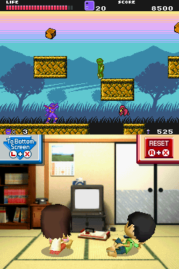
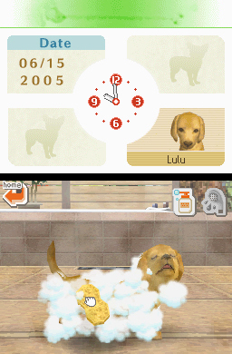
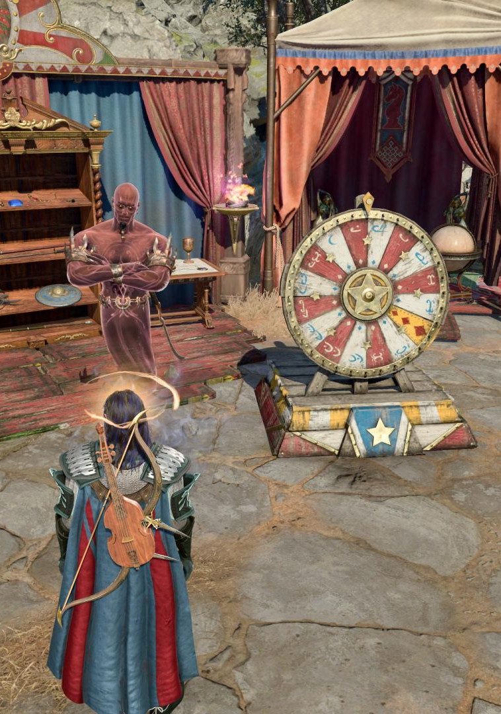
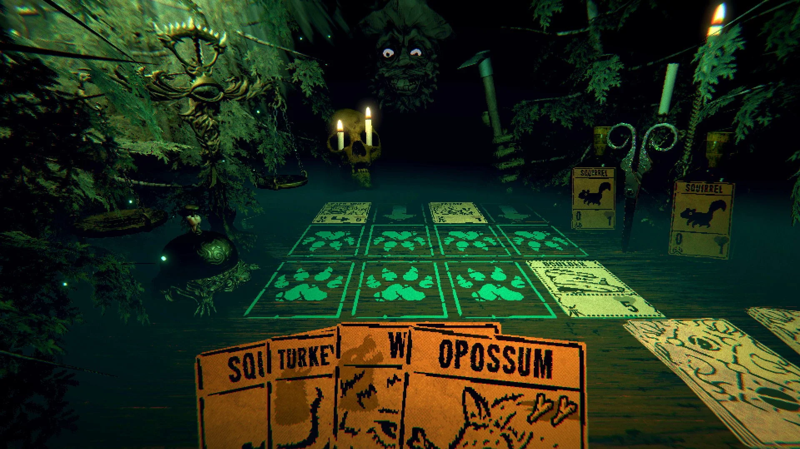

&nbsp;&nbsp;

&nbsp;&nbsp;

<i>'Retro Game Challenge', 'Nintendogs', 'Baldur's Gate 3' (from left to right) </i>

## Assignment
**Create a game project that contains within it, another game.  (A game within a game).**  
  
Games within games abound as a trope in videogames.  Common examples include in-game casinos with slot machines or card games. Meta experiments are not uncommon either, with the player character playing other videogames and referring back to the IRL player.  Less explicit examples are arguably even more widespread.  In particular, RPGs will wrap a battle within an exploration and dialogue focused game (role playing).  Embedded games serve many different functions.  They can deepen the sense of depth in a simulated world.  They can relieve tension, or act as a reward in between rounds of a higher stakes main mechanic.  They can serve as an aesthetic contrast.  They can also create another avenue of player choice, or add complexity to other mechanics in the game.

While entirely possible to make compelling games with more singular systems, much of the expressive and experiential power of videogames as medium lies in the interplay of multiple systems.  Furthermore, games within games represent a natural fit for the modular and multi-systemic nature of the game engine.

### Final Requirements
- **Playable, and complete** a tested, start-to-finish playable game (Windows Build + Unity package of project)  

- **Game-within-a-game** 2 clearly identifiable game-systems that interact with one another.  

- **Multiple scenes** There should be at least an opening title scene and a main, gameplay scene.  

### Guidelines & Suggestions:
- You do not need to make 2 separate fully fleshed out games.  1 could be very simple, (e.g. a text only branching narrative, a shell game, or a space-invaders like hacking-game)

- Don’t feel like you have to go all meta! (if it doesn’t feel your style, don’t do it!)

- Get creative with the prompt! Draw from your own interests and experiences. If your idea doesn’t sound, or feel like a game, it’s probably a good idea worth exploring.

- Think about how each of the systems and games might interact.  How might you create moments of surprise, or allow for unusual strategies?

- Consider how the prompt might allow for an interesting visual contrast. Many commercial games will have "retro" minigame interludes with pixelly, or low poly graphics. Hacking minigames often become abstract and geometric vs. a more photorealistic, representational style in the main game. (Not applicable to all projects)

- It can be helpful to think in terms of existing game genres, or control schemes (e.g. a first person walking simulator, where you must play hidden-object games in posters and murals throughout the world.  A branching narrative visual novel, controlled by an endless runner game)

- Be conscious of scope. You probably do not have time to design an original cardgame, and program an AI to play against. 

- If you have a more ambitious idea, it could be helpful to think of the project as a polished demo, or "vertical slice", a short chapter from a speculative larger work.  You don't necessarily have to tell the full story you have in mind.

## Due Dates

### Proposal Sketches  
(DUE: 10/16) **Upload your sketches [here](https://docs.google.com/forms/d/e/1FAIpQLScwtL8TVon9M6pODIq0KucbDteiOr4eJf3ZkdImrgRYUtvPzA/viewform?usp=header)**  
  
**Sketches x2**  
Come up with 2 game-within-a-game ideas. For each idea, write a couple sentences explaining your game, its 2 systems, and how those systems would interact.  Also make a rough sketch (hand drawn, or collaged from existing images, however you like) giving us some idea of how your game might look when played.

* Hand drawn and sketchy is fine.
* Have your sketch ready in class. We'll meet with everyone individually, and offer technical guidance, so don't worry too much if you're not sure how to do something.  

<!--
Save for final assignment, maybe
**Moodboard x1**  
For one of the ideas, also create a moodboard of a least 10 images that help illustrate reference for your proposed aesthetics, narrative, mechanics, and overall sensibility. No more than 5 images can be from existing games. You are encouraged to reference animals, fashion, foods, historical or mythical figures, artworks, old fads, weird youtube videos, etc...  Look for inspiration in unlikely places.-->

### Prototype (Graybox)  
 (DUE 10/30)  
A prototype of your game implemented with placeholder assets (e.g. cubes, and spheres), and showing at least partial implementation of the mechanics needed for your game. (e.g. character movement is working, you have a dialogue and NPC system set up, e.g. a rough layout of your world.)

You should have something playable in editor, and that demonstrates a clear conception of the completed project, and some progress towards it.

### Final Build + Project
 (DUE 11/6)   
*(submission link here soon)*

<i>Inscryption</i>

