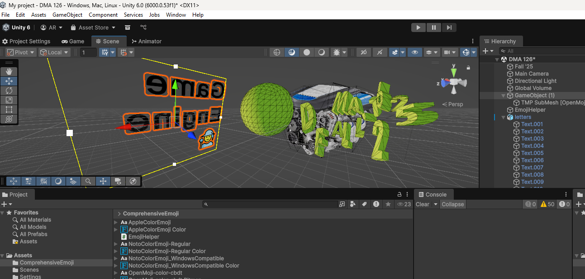

---
# Feel free to add content and custom Front Matter to this file.
# To modify the layout, see https://jekyllrb.com/docs/themes/#overriding-theme-defaults

layout: home
---
## DMA 126 : Game Engine
<table style="border: none; border-collapse: collapse;">
<colgroup>
<col width="50%" />
<col width="50%" />
</colgroup>
<tbody>
<tr>
<td markdown="span" style="border: none; vertical-align: top;">
**Location:**  
&emsp;Broad 4220  
 
**Times:**  
&emsp;Tuesday and Thursday: 2:00 - 4:50pm  
</td>

<td markdown="span" style="border: none; vertical-align: top;">
**Instructor:**  
&emsp;Alex Rickett _(he/any)_  
&emsp;[alexrickett@ucla.edu](mailto:alexrickett@ucla.edu)  
&emsp;**Office hours:**  
&emsp;&emsp;TBA (or by appointment)  
 
**TA:**  
&emsp;Sagan Yee _(he/they)_  
&emsp;[saganyee@g.ucla.edu](mailto:saganyee@g.ucla.edu)  
&emsp;**Office hours:**  
&emsp;&emsp;TBA (and by appointment)  
</td>
</tr>
</tbody>
</table>

## Course Description
This course introduces the fundamentals of programming interactive projects in game development software. Classwork focuses on familiarizing students with game engines, computer programming concepts, player experience, and other skills that are foundational to making digital games. Lectures, exercises, and class projects teach skills needed to create digital games including custom rules, interactive physics systems, vectors, generative or randomized levels, save data, custom input systems, score-keeping, and sound.
 
 
 
