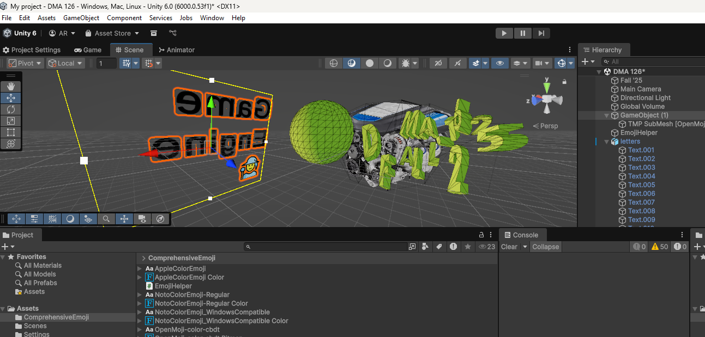

Welcome!  

# Itinerary for today:
- Introduce class, Syllabus
- Start Unity Install  
- Quick intro / history of game engines 
- Intro to Unity Editor
- Assign reading (due next Thursday)

# Class Intro

[Syllabus](/syllabus.md)  

[Schedule](/schedule.md) ←_subject to change_ 

# Start the Unity Install

If you plan to use your personal computer, please download Unity Hub, and Unity 2022.3.62 (it takes some time, so start now!)

1. Download and install [Unity Hub](https://unity.com/download)
2. Open Unity Hub and create a Unity Account or log in with an existing Unity account

	

3. Once you’ve logged in, install the Unity Editor. I recommend installing the most recent LTS Editor. This is currently 2022.3.XX You’ll have to agree to the license, then it will start to install. Make sure to click yes to any access requests from the Unity installer.

	
  
4. Make sure to also install Microsoft Visual studio and Windows build support. To make the submission process a bit easier, everyone should submit a Windows build of their project regardless of the OS that you are using.

	

5. You’ll want to include tools for working with Unity. When the box below shows up during the installation, check the “Game Development with Unity” box and uncheck the “Unity Hub” box in the Installation details panel (see image below). Click the Install button to continue. Skip making an account. Close Visual Studio when finished.
    
	
	Note: Unity does not come with its own code editor, so it’s necessary to install an external editor. Visual Studio is the recommended editor, but you can use other code editors that you are more familiar with (other popular editors with Unity include VS Code and JetBrains Rider). If you’re just starting out, I strongly recommend using Visual Studio because the setup is much less involved. Once we get into editing scripts, having working code completion for the Unity API will make your life so much easier.

# Brief History of Game Engines
Lecture / discussion while we wait for unity to download.
 
 
 
 
 
 
 
 
 
 
 
# Unity Hello World

6. Create a new Project. Back in Unity Hub. Select the Projects > New Project and then find the 3D URP template in the list (you may have to scroll down a bit, and you may need to click “download template”). You can name your project (consider calling it “Rollaball” because this is the first step of the homework), set the location of the project folder and click “Create Project”.
    
    

Let’s get our bearings and talk a little bit about how the Unity Editor works
## Layout

[https://docs.unity3d.com/Manual/UsingTheEditor.html](https://docs.unity3d.com/Manual/UsingTheEditor.html) 

From GMT’s Unity for beginners video (linked at the end)

The Unity Editor UI can be completely reconfigured (try out different layouts under Window > Layouts). You can always check the tab name at the top left. The four tabs that you’ll use the most are the Project, Hierarchy, Scene, and Inspector (maybe also the Game tab)

1. **Project tab** - Organize all your assets (images, scripts, sounds, 3d models, prefabs etc.) here. The folders and files in this tab correspond to the project folder on your computer. Assets need to be added into the Assets folder in order for your project to see them.
2. **Hierarchy** - Lists all of the Game Objects in your Scene. You can select game objects from here to edit them in the Inspector
3. **Scene** - This is a view to your scene. A scene is like a level. This are is where you’ll do  most of your construction and positioning of Game Objects
4. **Inspector** - When you select a Game Object in the Hierarchy or Scene tab or an asset in the Project tab. Details related to that object or asset will appear here.

Other important tabs:

**Game** - Located next to the Scene view in the default layout. You can see the view from the Main Camera in your scene here. This is the view that someone running your game will see.

**Console** - Next to the Project tab in the default layout. If there are any errors or problems with your game or scripts or something else. This is the place to look. Initially, it may be very difficult to diagnose issues from the errors in the console as they can seem cryptic, but after experiencing and troubleshooting problems you’ll eventually pick up on what different error messages are pointing to.

# Game Objects and friends

[https://docs.unity3d.com/Manual/GameObjects.html](https://docs.unity3d.com/Manual/GameObjects.html) 

Everything in Unity is a Game Object. Cameras, Lights, Sounds, Shapes, and so on. But a game object is really just a container for a set of [Components](https://docs.unity3d.com/Manual/Components.html) that are attached to the game object. When a game object is selected, you can see all of its components in the Inspector tab.

Create a GameObject:

1. With your scene open. Select **GameObject > 3D Object > Cube** to add a cube to your scene.
2. You can also right-click in the Hierarchy tab and select 3D Object > Cube
3. After creating the object you can immediately start typing to give it a name.

By default, every game object has a [Transform](https://docs.unity3d.com/Manual/class-Transform.html).  A transform keeps track of an object’s position, rotation, and scale within the 3D space of the scene. Even if the game object has nothing to do with position, for example background music or an inventory manager, there still has to be a transform. 

If you come from Maya, you can quickly edit the position, rotation, and scale of the game object in the scene view using the W, E, and R keys on the keyboard.

1. Select a GameObject (or multiple objects)
2. Press R to bring up the scale tool in the Scene
3. Press E to bring up the rotation tool
4. Press W to bring up the position tool

Tip: You can hold ‘ctrl’ while making adjustments to snap the values. 

# Components 

To add components to a GameObject. 

1. Select the object
2. Go to Components > (name of component you want to add) OR click the “Add Component” button at the bottom of the Inspector tab
3. You’ll see the new component in the Inspector, it is now attached to this GameObject.

Tip: You can duplicate objects with Ctrl+d, you can also right click an object in the Hierarchy and select duplicate.

Scripts in Unity usually exist as components attached to a GameObject. We’ll dive more into scripting later, but it’s good to understand this relationship. You can drag an existing script from the project folder to the Inspector of a selected GameObject. You can also click AddComponent and begin typing the name of the script. If the name isn’t found, you’ll have the option to create a new script with that name.

Try creating some game objects and add components to them. Starting with an empty GameObject try to recreate a different type of object with Components (Camera, Cube). Try to build a small house using only default 3D objects.
# Navigating in the scene view

[https://docs.unity3d.com/Manual/SceneViewNavigation.html](https://docs.unity3d.com/Manual/SceneViewNavigation.html) 

This is where you’ll want to have a 3 button mouse.

Focus on a Game Object

1. Double click on it in the Scene view
2. Select the object and press the ‘F’ key

Orbit around the focused object:

1. Hold the Alt key
2. Hold left-click and move the mouse

Move/Pan

1. Hold middle mouse button and move the mouse
  
Zoom on focused object:

1. Hold Alt key
2. Hold Right-click and move mouse
  

You can also quickly change views along a specific axis using the “Scene Gizmo”

Clicking the cube in the center of the gizmo will toggle the projection of the scene camera between Perspective mode (objects in the distance will appear smaller) and Isometric mode (objects in the distance stay the same size).

Another option for navigating the scene view is to hold the right mouse button and use WASD to fly the camera around the scene.

Now you can use these navigation tools to take a tour of your neighbor’s house. Visit the whole neighborhood!
# More resources

This [Unity quickstart video](https://youtu.be/XtQMytORBmM) from Game Maker’s Toolkit is very very useful to quickly get a sense of the workflow in Unity.

# Next Class: Roll-a-ball Tutorial 

[https://learn.unity.com/project/roll-a-ball](https://learn.unity.com/project/roll-a-ball) 

*Note: this tutorial was created with Unity version 2020.3, so there may be slight differences. If you are unable to get past one of the steps of the tutorial please reach out to the TA* 

# Class Survey

Let us know a bit more about yourself and your background.  

[https://forms.gle/eAiXzFwPTa4jn3Xa6](https://forms.gle/eAiXzFwPTa4jn3Xa6) 

