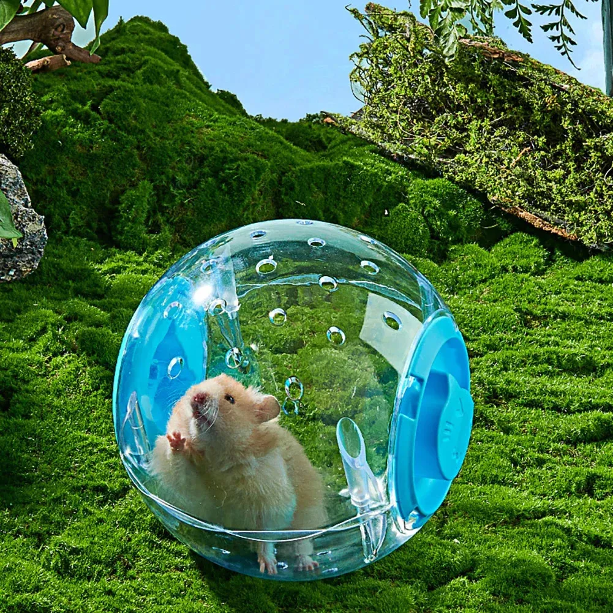

  
  
# Project 1

Project 1 will use the roll-a-ball tutorial as a starting point.  
Let's review it quickly.

## Parts of Unity that Roll-a-ball covers
- Lighting and Materials 
- Rigidbody Component / Physics
- Vectors, Colliders 
- Triggers, UI
- TextMeshPro
- Input System
- Prefabs

_Later, we'll cover most of these topics more in depth._

[Project 1 Info](/assignments/project-1) 

# Building Our Level (towards a more "real" game)

[ProBuilder Instructions](https://docs.google.com/document/d/1QoUTUwdZwhX3TZAKrWFhRk2UOW7pMafFnVjp-jzoiVk/edit?tab=t.0)

