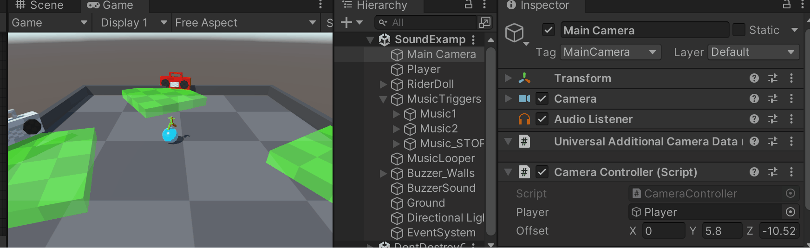

## Exporting your project & making builds
Everyone **_MUST_** follow along for this part.  
[Instructions Link](https://docs.google.com/document/d/1QoUTUwdZwhX3TZAKrWFhRk2UOW7pMafFnVjp-jzoiVk/edit?tab=t.54rx925hat49)

## Adding a title screen (Canvas+UI basics)
[Tutorial Link](https://docs.google.com/document/d/1QoUTUwdZwhX3TZAKrWFhRk2UOW7pMafFnVjp-jzoiVk/edit?tab=t.xovky3b51j95)

## Adding Sound
[Tutorial Link](https://docs.google.com/document/d/1QoUTUwdZwhX3TZAKrWFhRk2UOW7pMafFnVjp-jzoiVk/edit?tab=t.bdpjfk8ix27s)
  
The [roll-a-ball helpers package v2](https://drive.google.com/file/d/1jEmPGGdkODFsFNR0uNeVI2BVA3s-tVSO/view?usp=drive_link) includes an example scene demonstrating crossfading between different background music, and sound on collision.

## Work time
This is the last day in class to get help with your project 1. If you are having trouble getting some feature or mechanic working, please get help today!

**_Tip for testing your game more easily_**  
It can be helpful to temporarily move your 'player' object later in your level, so you don't have to play your whole game, if you're just trying to figure out one part.

You can download this version of [CameraController.cs](https://drive.google.com/uc?export=download&id=12zs-MpqYEQEYiaM3cEduz6oqCCZveld8) which will respect the manually input 'offset', regardless of the camera/player start positions.

