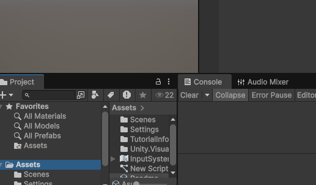
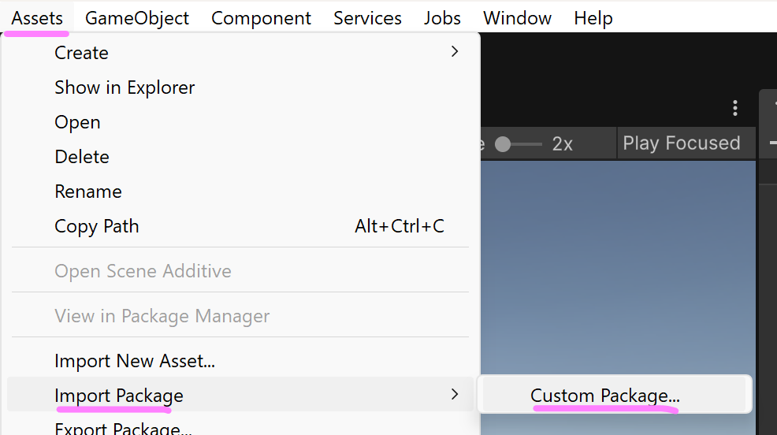
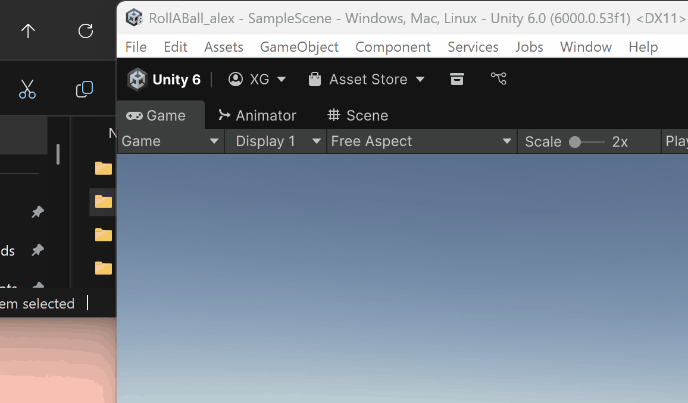

---
# Feel free to add content and custom Front Matter to this file.
# To modify the layout, see https://jekyllrb.com/docs/themes/#overriding-theme-defaults

layout: home
---
# Exporting Your Project

To back up your Unity files, you need to back up the entire contents of your Unity project folder, NOT just the .unity files.  
  
There are a couple ways to do this, but The easiest way to do this is create a unity package:

## Method 1: Create a Unity package (Recommended)
  

**Instructions**  
**_To Export the package..._**
- In Unity, right click on the 'Assets' folder in the project tab
- Choose "Export Package"
- In the window that opens, verify that is shows a big list of all the files in your project, and hit Export
- Give the file a sensible name, and save it.

**_To Import the package..._**
- Create or open a project where you'll import the package  
_(Note: importing a package will overwrite any duplicate files, so be careful)_
- Go to _Assets/Import Package_ and select your package file  

  

&emsp;_OR_  
Drag and drop the package file into the project tab

  

_pros: simple, small filesize_  
_cons: doesn't include certain project settings in the transfer (not typically a problem)_

 
 
 
 
   
## 2: Copy the entire Unity Project folder
**Only do this if you have issues with method one**

**_Instructions_**
- **(IMPORTANT) QUIT UNITY!**
- ...
- Really, did you quit unity?
- (Optional, but highly recommended) temporarily move the 'Library' folder onto your desktop, or otherwise outside the project folder.  
_The 'Library' is a very large folder that does not contain anything unique to your project, and is just a cache of files that can be regenerated._ 
- Zip the folder.
- Move the library back.

  

_pros:_ Includes all project settings. Don't need import step.  
_cons:_ Very easy to mess up.  

_PRO TIP: Zipped files transfer to/from USB drives significantly more quickly than raw project folders_

_NOTE: you can also delete the Library folder of your project to save space if you know you won't be opening your project for a while._

## 3: Use Version Control (Like Git, or Unity's built-in version control)  
_This is an advanced method.  Either investigate on your own, or check with the instructor._